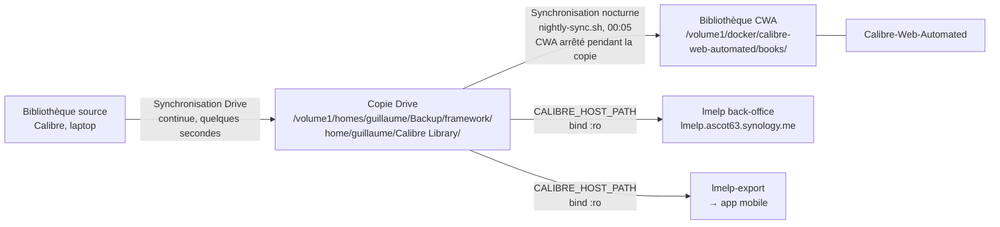

# lmelp lit la copie Drive, pas la bibliothèque CWA

lmelp (back-office et `lmelp-export`) lisait la **bibliothèque CWA**, rafraîchie une fois
par nuit par la **synchronisation nocturne** : une modification faite dans Calibre n'apparaissait
dans lmelp que le lendemain (mesuré le 7 novembre 2026 : 10 livres modifiés dans la journée,
prod figée sur l'état de la veille à 18:15). Nous montons désormais la **copie Drive** dans
lmelp, mise à jour en quelques secondes par Synology Drive, ce qui ramène le délai de mise à
disposition à quelques minutes sans toucher à CWA, qui garde sa synchronisation nocturne pour
lui seul.

Seule la bibliothèque source fait foi : ce que CWA écrit dans sa bibliothèque n'a pas à être
visible dans lmelp (la synchronisation nocturne l'écrase de toute façon).

## Considered Options

- **Lancer la synchronisation nocturne toutes les quelques minutes** : écartée, chaque passage
  arrête CWA (qui écrit dans sa bibliothèque), soit plus d'une centaine de coupures par jour.
- **Synchronisation à la demande depuis lmelp** (bouton qui déclenche le rsync) : écartée, le
  retard reste le comportement par défaut et chaque clic coupe CWA.

## Consequences

- Drive peut remplacer `metadata.db` pendant une lecture : lmelp relance brièvement la lecture
  avant de considérer Calibre indisponible.
- La **fraîcheur Calibre** est affichée sur la page « À propos », en orange au-delà d'une heure,
  pour voir immédiatement si la synchronisation Drive a décroché (laptop éteint, client Drive
  en pause).
- La synchronisation nocturne ne sert plus que CWA : la contrainte d'horaire entre
  `nightly-sync.sh` et `lmelp-export` (documentée dans `docker-lmelp`) disparaît.
- Revenir en arrière ne demande que de remettre `CALIBRE_HOST_PATH` sur la bibliothèque CWA.
